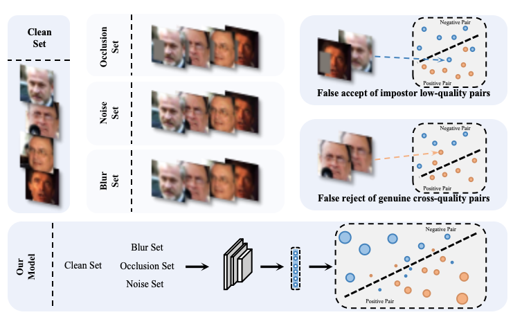

<p align="center"></p>

# RipPLE: Concentric Hypersphere Embedding for Pairwise Similarity Learning

PyTorch implementation of **"Concentric Hypersphere Embedding for Pairwise Similarity Learning"** (under review).

[](https://arxiv.org/abs/XXXX.XXXXX)
[](https://pytorch.org/)
[](LICENSE)

## Introduction

**RipPLE** is a pairwise learning method for face recognition built on **concentric hypersphere embedding**. Standard practice normalizes embeddings onto a hypersphere and compares them by angle, but the angular score only tells **how similar** two faces appear, not **how much evidence** supports that similarity: under occlusion, extreme pose, or blur, impostor pairs score higher and genuine pairs lower until no threshold separates them, the *feature ambiguity dilemma*, which directly lowers the true acceptance rate at the low FARs that security applications demand. RipPLE instead lets embeddings keep different norms: the **direction encodes identity**, and the **norm expresses how much evidence the input provides**, learned end-to-end by the pairwise loss and used in scoring at inference. Because the norm also scales every logit and acts as the temperature of the loss, where an unconstrained norm hampers convergence while fixing every norm removes the evidence, RipPLE introduces the **expected norm constraint (ENC)**: anchor only the mean norm over the training set, leaving every individual norm free to grow for clear faces and shrink for degraded ones. Under degradation the norm decreases, so the scores of genuine and impostor pairs alike converge toward zero rather than overlapping, and a small absolute score marks a pair as *hard to decide* rather than *wrongly decided*.

<p align="center">
  
  <br>
  <em>At a fixed threshold, degradation such as occlusion, noise and blur causes two failure modes: degraded impostor pairs are falsely accepted, and genuine pairs that cross quality levels are falsely rejected, which is the feature ambiguity dilemma. RipPLE encodes how much evidence each input provides in the embedding norm, shown by the marker size, so degraded pairs converge toward the decision boundary and are marked as hard to decide rather than wrongly decided.</em>
</p>

## Key Features

- **Loss heads**: the four anchoring forms of the expected norm constraint, `RipPLE` (arithmetic mean, main form), `RipPLE-R` (with asymmetric temperature), `RipPLE-GM` (geometric mean), `RipPLE-P` (per-pair), plus the [SimPLE](https://arxiv.org/abs/2310.09449) baseline and supervised proxies (Softmax, [CocoLoss](https://arxiv.org/pdf/1710.00870.pdf), [SphereFace](https://wyliu.com/papers/LiuCVPR17v3.pdf), [CosFace](https://arxiv.org/pdf/1801.09414.pdf), [ArcFace](https://arxiv.org/pdf/1801.07698.pdf), [SphereFace2](https://wyliu.com/papers/sphereface2_ICLR22.pdf))
- **Backbones**: [IResNet-100](https://openaccess.thecvf.com/content_cvpr_2016/papers/He_Deep_Residual_Learning_CVPR_2016_paper.pdf), [SFNet-64](https://wyliu.com/papers/spherefacer_v3_TPAMI.pdf)
- **Datasets**: training on [MS1MV2](https://arxiv.org/pdf/1607.08221.pdf); validation on [LFW](http://vis-www.cs.umass.edu/lfw/), [AgeDB-30](https://ibug.doc.ic.ac.uk/media/uploads/documents/agedb.pdf), [CALFW](https://arxiv.org/pdf/1708.08197.pdf), [CPLFW](http://www.whdeng.cn/CPLFW/Cross-Pose-LFW.pdf), [CFP-FP](http://www.cfpw.io/); testing on [IJB-B](https://openaccess.thecvf.com/content_cvpr_2017_workshops/w6/papers/Whitelam_IARPA_Janus_Benchmark-B_CVPR_2017_paper.pdf) and [IJB-C](http://biometrics.cse.msu.edu/Publications/Face/Mazeetal_IARPAJanusBenchmarkCFaceDatasetAndProtocol_ICB2018.pdf)
- **Protocols**: 1:1 verification (TAR@FAR), 1:N identification (TPIR@FPIR, rank-1), image-level norm filtering, embedding extraction on arbitrary image folders
- **Training**: proxy-free pairwise training with DDP and a MoCo-style EMA feature bank

## Anchoring forms of the constraint

Every anchoring form fixes the overall scale of the norms but differs in what it anchors. The constraint is needed because the norm also scales every logit and thus acts as the temperature of the loss: unconstrained it hampers convergence, fixed per sample it removes the evidence. ENC anchors only the collective scale of the norms; each individual norm is then steered by the pairwise loss alone and grows only when its direction already supports the correct decision. Three anchoring losses are implemented:

| Form | $L_{\mathrm{ENC}}$ | Head |
|:---|:---|:---|
| **Arithmetic mean** (main form) | $\mathrm{SmoothL1}(\mathrm{mean}(\lVert x \rVert), \rho)$ | `RipPLE` |
| **Geometric mean** | $\mathrm{SmoothL1}(\exp(\mathrm{mean}(\log \lVert x \rVert)), \rho)$ | `RipPLE-GM` |
| **Per-pair** | $d^2_{ij}/(s_i+s_j) + \log(s_i+s_j)$ | `RipPLE-P` |

**Arithmetic mean (RipPLE).** The mean norm $\rho$ sets the loss temperature that training and inference share, so a typical logit is $\rho^2(\cos\theta - b_\theta)$. Every individual norm stays free to carry evidence, which gives the best verification accuracy. `SimPLE+ENC` (`RipPLE-R`) is this form combined with SimPLE's asymmetric temperature.

**Geometric mean (RipPLE-GM).** Anchors $\exp(\mathrm{mean}(\log \lVert x \rVert))$, the multiplicative center of the radii. It is exact under the exponential norm map, where $\log \lVert x \rVert$ is linear in the output coordinate, and suits radii that span orders of magnitude; performance lands close to the arithmetic form.

**Per-pair (RipPLE-P).** With $s_i = (\rho/\lVert x_i \rVert)^2$ and the batch-normalized squared directional difference $d^2_{ij}$ (detached), the first-order condition $s_i+s_j = d^2_{ij}$ ties each pair's scales to its directional difference, and the log term prevents collapse. Verification is slightly below the mean forms, but the norm becomes readable image by image: ranking template frames by norm and discarding the lowest-ranked fraction moves TAR@FAR=1e-4 from 94.71 to 98.37 on IJB-B and from 96.60 to 99.47 on IJB-C, above PFE's uncertainty ranking.

## Results

**IJB-B / IJB-C, IResNet-100, trained on MS1MV2 (240k steps).** 1:1 TAR@FAR and 1:N TPIR@FPIR; `top1` is rank-1 identification. Compared-method numbers are quoted from their respective papers.

| Method | IJB-B 1e-6 | IJB-B 1e-5 | IJB-B 1e-4 | IJB-C 1e-6 | IJB-C 1e-5 | IJB-C 1e-4 | 1:N top1 (B/C) | 1:N TPIR@1e-2 (B/C) |
|:---|:---:|:---:|:---:|:---:|:---:|:---:|:---:|:---:|
| SimPLE | 49.87 | 91.13 | 94.78 | 90.30 | 94.34 | 96.27 | 95.54 / 96.81 | 85.92 / 92.88 |
| SimPLE+ENC (`RipPLE-R`) | **51.89** | 91.88 | 95.35 | 90.55 | 94.61 | 96.66 | 95.42 / 96.78 | 84.34 / 93.01 |
| **RipPLE** | 44.72 | **92.57** | **95.50** | **92.13** | **95.09** | **96.82** | 95.41 / 96.75 | **87.21 / 93.89** |
| RipPLE-P | 44.63 | 92.19 | 95.37 | 90.19 | 94.93 | 96.67 | 95.05 / 96.34 | 85.29 / 93.29 |
| RipPLE-GM | 38.76 | 92.01 | 95.20 | 90.75 | 94.78 | 96.58 | 95.27 / 96.58 | 87.32 / 93.30 |

## Setup

```console
git clone <this-repo>
cd Ripple
conda env create -f environment.yml
conda activate ripple
```

## Data preparation

Place data under `data/` (paths follow the training configs):

```console
bash scripts/dataset_setup.sh        # validation + testing sets
bash scripts/dataset_setup_ms1m.sh   # training set
```

Alternatively, unpack an InsightFace-style MS1M recordIO into the expected layout (`data/train/ms1m_arcface/ms1m_arcface_112x112` + `.lst`):

```console
bash scripts/extract_ms1m_train.sh
```

## Training

All experiments use `ProxyFreeTrainer` (EMA feature bank of 524288, momentum 0.999). To train RipPLE with IResNet-100 on MS1M with 2 GPUs:

```console
CUDA_VISIBLE_DEVICES=0,1 torchrun --nproc_per_node=2 main_train.py \
    --cfg_path config/train/ms1m_iresnet100_ripple.yml \
    --proj_dir project/ripple
```

## Testing

After training, the model is saved in `project/<method>/<timestamp>`:

```console
CUDA_VISIBLE_DEVICES=0,1 python main_test.py --cfg_path config/test/ijbc.yml --proj_dir project/ripple/<timestamp>
CUDA_VISIBLE_DEVICES=0,1 python main_test.py --cfg_path config/test/combined.yml --proj_dir project/ripple/<timestamp>
```

To extract features and scores for arbitrary image folders (MTCNN alignment included):

```console
python main_inference.py --image_dir <your_images> --proj_dir project/ripple/<timestamp>
```

## Acknowledgements

This repository is a research project built on top of [**OpenSphere**](https://github.com/ydwen/opensphere) — the training/testing framework, backbones (IResNet, SFNet), the SimPLE head, and the proxy-based baseline heads are inherited from it (the `opensphere/` package name is kept in tribute). The EMA feature bank in `proxy_free_trainer.py` is adapted from [MoCo](https://github.com/facebookresearch/moco). Face alignment in `face_alignment/` uses the [MTCNN PyTorch](https://github.com/DuinoDu/mtcnn) implementation. MS1M is unpacked with a script based on InsightFace's `rec2image.py`. We gratefully thank all these authors for open-sourcing their work.

## Citation

If you find this work useful, please cite: (a) the RipPLE paper (under review — bib entry will appear here upon release), and (b) the works this project builds on:

```bibtex
@inproceedings{wen2023simple,
  title     = {Pairwise Similarity Learning is SimPLE},
  author    = {Wen, Yandong and Liu, Weiyang and Feng, Yao and Raj, Bhiksha and Singh, Rita and Weller, Adrian and Black, Michael J. and Sch{\"o}lkopf, Bernhard},
  booktitle = {ICCV},
  year      = {2023}
}

@article{liu2022spherefacer,
  title     = {SphereFace Revived: Unifying Hyperspherical Face Recognition},
  author    = {Liu, Weiyang and Wen, Yandong and Raj, Bhiksha and Singh, Rita and Weller, Adrian},
  journal   = {IEEE Transactions on Pattern Analysis and Machine Intelligence},
  year      = {2022}
}

@inproceedings{shi2019pfe,
  title     = {Probabilistic Face Embeddings},
  author    = {Shi, Yu and Jain, Anil K.},
  booktitle = {ICCV},
  year      = {2019}
}

@inproceedings{he2020moco,
  title     = {Momentum Contrast for Unsupervised Visual Representation Learning},
  author    = {He, Kaiming and Fan, Haoqi and Wu, Yuxin and Xie, Saining and Girshick, Ross},
  booktitle = {CVPR},
  year      = {2020}
}

@article{zhang2016mtcnn,
  title   = {Joint Face Detection and Alignment Using Multitask Cascaded Convolutional Networks},
  author  = {Zhang, Kaipeng and Zhang, Zhanpeng and Li, Zhifeng and Qiao, Yu},
  journal = {IEEE Signal Processing Letters},
  year    = {2016}
}
```

## License

This project is released under the [MIT License](LICENSE), inheriting the MIT License of OpenSphere. Third-party components keep their original licenses (see `face_alignment/mtcnn_pytorch/LICENSE`).
